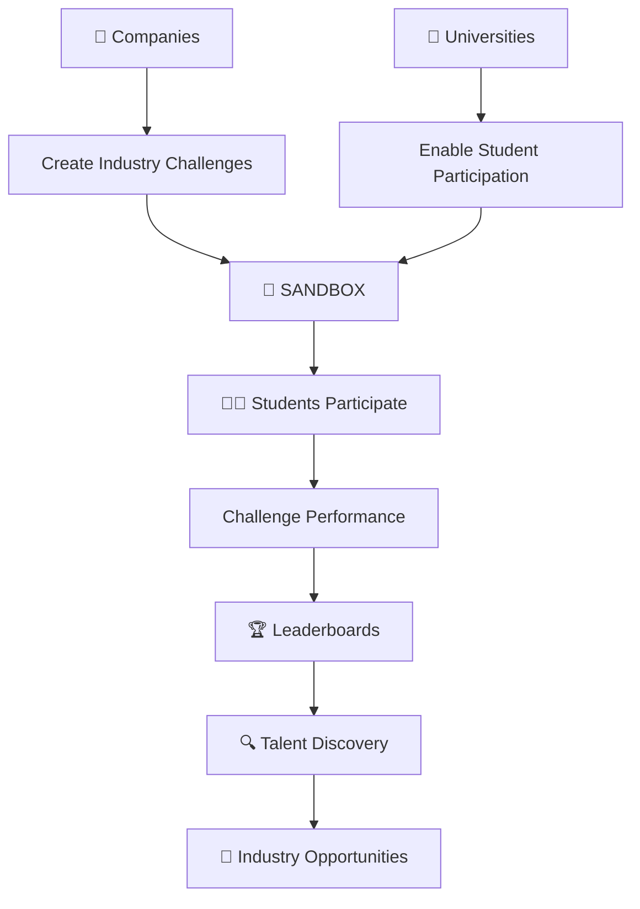

# 🚀 SANDBOX — Where Talent Meets Opportunity

  
  
  

<h3 align="center">
  Turning Skills Into Opportunities.
</h3>

  A challenge-driven platform connecting students, universities, and companies through real-world problem solving, skill development, and verified performance.

---

## 🌟 What is Sandbox?

**Sandbox** is a skill-first platform designed to bridge the gap between academic learning and industry expectations.

Traditional hiring often relies heavily on resumes, academic scores, and theoretical knowledge. But these don't always reflect what someone can actually build, solve, or accomplish.

Sandbox approaches this differently.

We create an environment where students can participate in challenges, demonstrate their abilities, build a track record of performance, and get discovered through what they actually do.

Companies can introduce real-world challenges, evaluate participants, discover promising talent, and connect with people who demonstrate the skills they need.

Universities can use Sandbox as an additional platform to encourage practical learning, identify high-performing students, and connect academic talent with industry opportunities.

**We believe talent should be demonstrated, not just described.**

---
live link : https://sandbox-platform.vercel.app/login
---
## 💡 The Problem We're Solving

The gap between education and employment is not just about learning more. It's about demonstrating what has been learned.

| The Challenge | What Happens Today |
|---|---|
| 🎓 Limited practical exposure | Students often lack opportunities to solve industry-oriented problems. |
| 📄 Resume-based screening | Companies struggle to understand candidates' actual capabilities. |
| 🔍 Talent discovery | Skilled students can remain unnoticed despite their abilities. |
| 🏫 Industry–university gap | Universities need better ways to connect students with practical industry challenges. |
| 📊 Lack of performance visibility | There is no consistent picture of how students perform across challenges. |

Sandbox aims to bring these pieces together through one challenge-driven ecosystem.

---

## ✨ What Makes Sandbox Different?

Sandbox is not just another learning platform or coding practice website.

It focuses on **demonstrated ability and measurable performance.**

- 🧠 **Skills Over Claims:** Give students opportunities to demonstrate their actual capabilities.
- 🏆 **Performance-Based Recognition:** Use challenge participation and leaderboards to highlight performance.
- 🏢 **Industry Connection:** Enable companies to introduce practical challenges and discover talent.
- 🎓 **University Integration:** Create opportunities for institutions to engage students through structured challenges.
- 🌍 **Inclusive Participation:** Support students and early-career professionals across different engineering and technical domains.
- 📈 **Talent Discovery:** Help organizations identify promising participants through demonstrated work.

---

## 🎯 Platform Ecosystem

Sandbox is designed around three major stakeholders.

### 👩‍💻 1. Students

A place to explore, participate, compete, and demonstrate skills.

- Participate in real-world and industry-oriented challenges.
- Solve problems across different technical domains.
- Build a record of challenge participation and performance.
- Compete through leaderboards.
- Demonstrate practical capabilities beyond academic scores.
- Get opportunities to become visible to potential employers.

### 🏢 2. Companies

A platform to discover talent through practical challenges.

- Introduce industry-oriented challenges.
- Evaluate participants based on challenge performance.
- Discover promising students and early-career professionals.
- Explore performance-based leaderboards.
- Identify potential candidates through demonstrated skills.
- Build stronger connections with emerging talent.

### 🏫 3. Universities

An opportunity to bring practical learning closer to students.

- Enable institution-focused participation.
- Encourage students to engage in practical challenges.
- Identify high-performing participants.
- Explore student performance and engagement.
- Introduce industry-oriented challenges.
- Strengthen connections between students, institutions, and companies.

---

## 🏆 Our Vision

Imagine a world where:

- A student from a small college can demonstrate exceptional technical ability.
- A company can discover talent without depending entirely on college rankings.
- A university can identify its strongest performers through actual participation.
- Students can build credibility through the work they complete.
- Companies and institutions can collaborate around real-world challenges.

That is the ecosystem we want Sandbox to create.

**The future of hiring should focus on what people can do, not just what their resumes say.**

---

## 🛠️ Technology Stack

Sandbox is built using modern web technologies.

  
  
  
  
  
  
  

| Layer | Technologies |
|---|---|
| Frontend | React.js, Tailwind CSS |
| Backend | Node.js, Express.js |
| Database | MongoDB / Firebase |
| Authentication | Firebase Authentication / JWT |
| Real-time Communication | Socket.IO |
| Version Control | Git, GitHub |

---

## 🏗️ How Sandbox Works

The platform follows a challenge-driven talent discovery approach.

---

## 🌱 Our Development Journey

Sandbox is being developed with a focus on building a practical and scalable ecosystem.

Our journey includes:

- 💡 Identifying the gap between academic learning and industry requirements.
- 🛠️ Building the initial platform.
- 🧪 Conducting an early beta pilot with student participants.
- 📊 Exploring challenge participation and engagement.
- 🏫 Working towards university-oriented adoption.
- 🏢 Developing opportunities for company participation.
- 🚀 Expanding the platform to support a wider range of technical domains.

---

## 🗺️ Roadmap

Our long-term direction includes:

- [x] Initial platform development
- [x] Early beta testing
- [x] Student-focused challenge experience
- [ ] Expanded industry challenge ecosystem
- [ ] Advanced university onboarding
- [ ] Institution-specific performance insights
- [ ] Enhanced talent discovery workflows
- [ ] Verified participant profiles
- [ ] Advanced challenge analytics
- [ ] Scalable multi-institution ecosystem
- [ ] Broader domain support beyond software development

---

## 🤝 Who Is Sandbox For?

Sandbox is built for anyone who believes practical ability deserves recognition.

- Students who want to prove their skills.
- Early-career professionals who want to build credibility.
- Companies looking for emerging talent.
- Universities interested in practical learning and industry engagement.
- Organizations that want to discover talent through real-world problem solving.

---

## 👩‍🚀 Founding Team

Sandbox is built by a team passionate about technology, innovation, and creating meaningful opportunities.

| Founder |
|---|---|
| **Srividya Ponnaganti** | 
| **Khushi Sarawagi** | 
| **Ishika Sharma** | 

We share a common vision: building a platform that makes opportunities more accessible and talent more visible.

---

## 🌍 Our Mission

We don't want students to be judged only by their academic records.

We want them to have an opportunity to demonstrate their capabilities, solve meaningful problems, and build a reputation through their work.

We want companies to discover people through demonstrated skills.

We want universities to become active participants in practical talent development.

**Sandbox is our attempt to bring all three together.**

---

<h2 align="center">
  🚀 BUILD. COMPETE. DEMONSTRATE. GET DISCOVERED.
</h2>

  <b>Sandbox — Where Potential Becomes Proof.</b>

  Built with ❤️ by the Sandbox Team.

---

  ⭐ If you believe in skill-first opportunities, support the vision.

